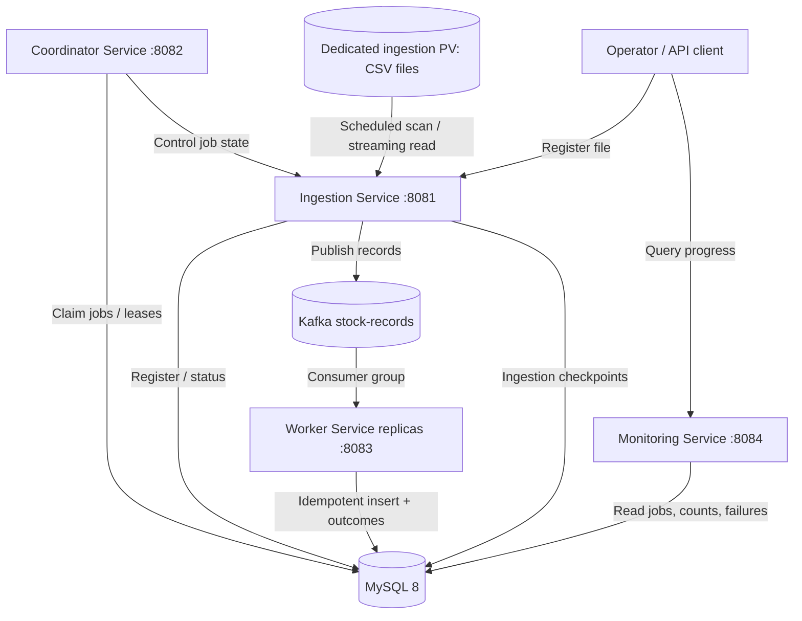

# Stock File Processing System — Architecture

**Version:** 1.0 (design baseline)  
**Updated:** 2026-10-27  
**Status:** Project skeleton verified; business processing and infrastructure integrations planned.

## 1. Purpose and scope

Process CSV files of **1–50 GB** containing potentially hundreds of millions of **independent stock records** without loading entire files into memory. Support scheduled discovery and REST registration, durable recovery, parallel processing, and observable operations.

### Nonfunctional goals

- Memory usage bounded independently of file size.
- At-least-once transport with effectively-once database effects through idempotency.
- Resume safely after process crashes, Kafka outages, and pod restarts.
- Scale Kafka consumers horizontally; isolate the single ingestion filesystem owner.
- Trace every input record to a file, line/record number, and processing outcome.

> Throughput, latency, recovery-time, and retention targets require benchmarking and operational decisions; no numeric SLA is assumed here.

## 2. Technology baseline

| Layer | Choice |
|---|---|
| Runtime | Java 25, Spring Boot 4.1.2 |
| Build | Maven multi-module (`com.stockprocessing`, `1.0.0-SNAPSHOT`) |
| Database | MySQL 8 / InnoDB |
| Event transport | Apache Kafka |
| Packaging | Docker |
| Orchestration | Kubernetes / OpenShift |
| CI/CD | Jenkins |
| Local integration | Docker Compose (planned) |

## 3. Context and component diagram



**Control-plane boundary:** Coordinator owns durable job-state transitions and claims. Ingestion owns file access and publication. Worker owns business processing and persistence. Monitoring is read-oriented.

The diagram is a **target design**; cross-service control APIs/protocols are not implemented yet.

## 4. Maven modules

```text
stock-file-processing/
├── pom.xml                         # parent / reactor
├── stock-common/                   # shared contracts, identifiers, utilities
├── stock-ingestion-service/        # :8081; registration, scan, CSV streaming, Kafka producer
├── stock-coordinator-service/      # :8082; jobs, scheduling, lease/claim coordination
├── stock-worker-service/           # :8083; Kafka consumer, validation, MySQL persistence
└── stock-monitoring-service/       # :8084; job status and progress APIs
```

**Verified so far (Epic 1):** Maven reactor build succeeded across parent and five modules; ingestion, coordinator, worker, and monitoring REST/Actuator endpoints were checked. The ingestion REST mapping initially returned 404 and was corrected; later returned HTTP 200. These checks validate application skeletons, **not** end-to-end file processing.

## 5. Main processing sequence

1. CSV arrives on the ingestion server's persistent volume via an external delivery mechanism.
2. Scheduled scan or `POST /api/v1/files` registers its canonical path and metadata; deduplication prevents accidental double registration.
3. Coordinator claims the job under a time-limited lease; state changes are committed in MySQL.
4. Ingestion opens the file as a streaming reader, validates header/schema, and reads bounded batches of lines.
5. Each valid record is assigned a deterministic identity (for example `file_id + record_number`) and sent to Kafka with file/job/position metadata.
6. Producer awaits acknowledgments for a bounded set of in-flight records; durable ingestion checkpoint advances only over the **contiguous acknowledged prefix**.
7. Worker replicas consume partitions, validate business rules, and write idempotently to MySQL.
8. Workers commit Kafka offsets only after the corresponding database transaction succeeds; failed records follow a deliberate retry/DLQ policy.
9. Monitoring reports published, processed, failed, and pending counts; a job completes only when the chosen completion invariant is met.

## 6. File ingestion topology

- **One dedicated ingestion server/pod** with access to the local PersistentVolume; use a single-writer deployment strategy and a suitable PV access mode.
- Do not assume a local PV can be remounted on arbitrary Kubernetes nodes. Pin scheduling to the PV's node and plan recovery when that node fails.
- Registration and scanner must share a canonical-path/file-identity deduplication rule.
- Avoid processing files while they are still being copied: require atomic rename to a ready directory or an explicit ready marker.
- Use streaming parsing with a bounded producer in-flight window; apply backpressure when Kafka is slow.

## 7. Kafka topology

Suggested logical topics (names subject to implementation):

| Topic | Producer | Consumer | Purpose |
|---|---|---|---|
| `stock.records.v1` | Ingestion | Worker group | Per-record work |
| `stock.records.dlq.v1` | Worker | Operations/replay workflow | Non-retryable or exhausted failures |
| `stock.job.events.v1` (optional) | Services | Monitoring/operations | State-change notifications; MySQL remains source of truth |

- Partition count is provisioned explicitly; Kafka does **not** automatically add partitions to match consumer count.
- Partition key choice depends on ordering requirements. Independent records allow distribution by record ID/hash; no global order is promised.
- Enable producer idempotence, `acks=all`, bounded retries, and appropriate replication/min-ISR for the target cluster.
- Kafka producer idempotence alone does not make MySQL writes exactly-once. Database uniqueness and transactional offset discipline remain essential.

## 8. Data stores and responsibility

MySQL is authoritative for job lifecycle, leases, checkpoints, record outcomes, and business records. Kafka is the durable transport between ingestion and workers; it is not a permanent audit database. The CSV file remains available until ingestion has completed and retention policy permits deletion.

## 9. Failure boundaries and recovery

| Failure | Intended recovery |
|---|---|
| Ingestion process crashes | Lease expires; resume from last **durable, contiguous** Kafka-acknowledged checkpoint; duplicate replay allowed |
| Kafka unavailable | Stop advancing checkpoint; backpressure/retry with bounded resources |
| Worker crashes before DB commit | Kafka redelivery; record not committed |
| Worker crashes after DB commit, before offset commit | Kafka redelivery; unique record key prevents duplicate business effect |
| Invalid CSV line | Capture file/line/error; skip or quarantine per explicit policy, without losing position accounting |
| Node hosting local PV fails | Ingestion unavailable until that node/storage recovers or file is restored; no automatic cross-node failover assumption |
| MySQL outage | No job/record commit; retry with backoff; avoid committing Kafka offsets prematurely |

## 10. Kubernetes / OpenShift deployment

```mermaid
flowchart LR
    subgraph Cluster[Kubernetes / OpenShift]
      IP[Ingestion pod: 1 replica] --- PV[(Node-local PV)]
      CP[Coordinator pod(s)]
      WP[Worker deployment: N replicas]
      MP[Monitoring deployment]
      K[(Kafka cluster)]
      DB[(MySQL service)]
      IP --> K
      K --> WP
      IP --> DB
      CP --> DB
      WP --> DB
      MP --> DB
    end
```

- Configure readiness/liveness probes, requests/limits, graceful shutdown, and PodDisruptionBudgets where appropriate.
- Ingestion requires PV/node affinity and a single active file reader per claimed job.
- Worker scaling is bounded by Kafka partitions, MySQL capacity, and downstream throughput.
- Keep secrets in Kubernetes Secrets or approved secret management, not in Git.
- Prefer migrations and backup/restore testing before production rollout.

## 11. Observability

Track jobs discovered, files claimed, lines read, records published, records persisted, duplicate replays, invalid records, DLQ events, checkpoint lag, Kafka consumer lag, lease expirations, and processing rate. Correlate logs by `jobId`, `fileId`, `recordNumber`, and trace ID where available. Keep `/actuator/health` distinct from business progress.

## 12. Security

Protect registration/monitoring endpoints with authentication and authorization; validate canonical file paths against an allowlisted root; prohibit path traversal and symlink escape; use Kafka/MySQL TLS and least-privilege credentials; redact sensitive record contents from logs and DLQs as required.

## 13. Architectural decisions to finalize

1. File immutability/ready marker and checksum strategy.
2. CSV dialect, encoding, quoting/newlines, header validation, and record schema.
3. Checkpoint position: line/record number plus byte offset only if parser guarantees safe seek boundaries.
4. Record-level validation policy and DLQ retention/replay mechanism.
5. Completion semantics: ingestion complete vs processing complete vs complete-with-errors.
6. MySQL partitioning/index/retention plan at hundreds-of-millions scale.
7. Kafka partition count, replication, retention, and partition key.
8. Backup, disaster recovery, and local-PV node failure procedures.

## 14. Delivery roadmap

- **Completed:** Epic 1, initial Maven modules, Spring Boot startup, REST status, Actuator health.
- **Planned:** Epic 2 database schema; Epic 3 registration; Epic 4 coordination; Epic 5 CSV streaming; Epic 6 Kafka producer; Epic 7 checkpoints/recovery; Epic 8 consumer/persistence; Epic 9 monitoring; Epic 10 Docker/OpenShift; Epic 11 Jenkins; Epic 12 performance/reliability.
