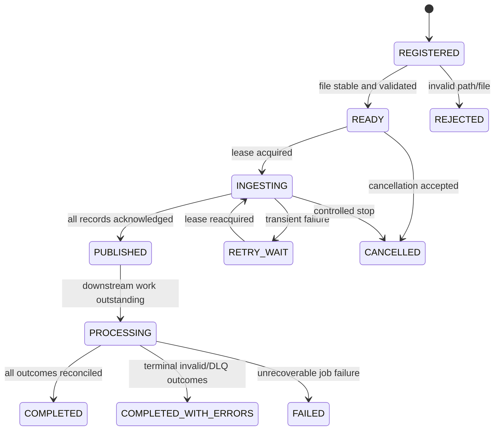

# Stock File Processing System — Detailed Design

**Version:** 1.0 (proposed design; not implemented)  
**Updated:** 2026-10-27  
**Baseline:** Java 25, Spring Boot 4.1.2, Maven groupId `com.stockprocessing`, MySQL 8, Kafka.

See [ARCHITECTURE.md](ARCHITECTURE.md) for the system-level view.

## 1. Functional requirements

- Register files via REST and discover ready CSV files through scheduled scanning.
- Stream 1–50 GB files without retaining the full file in memory.
- Publish each independent stock record to Kafka with deterministic identity and source position.
- Resume ingestion after crashes with bounded replay and no silent gaps.
- Coordinate job ownership through durable leases.
- Persist processed records idempotently in MySQL.
- Report counts, progress, failures, and audit data.

## 2. Module and package design

| Module | Suggested packages | Responsibility |
|---|---|---|
| `stock-common` | `model`, `dto`, `event`, `error` | Shared immutable contracts; avoid coupling services to JPA entities |
| `stock-ingestion-service` | `controller`, `service`, `scanner`, `parser`, `producer`, `checkpoint`, `config` | Register, scan, stream, publish |
| `stock-coordinator-service` | `controller`, `service`, `scheduler`, `lease`, `repository` | Claim jobs, renew/expire leases, transitions |
| `stock-worker-service` | `consumer`, `service`, `repository`, `validation`, `config` | Consume, validate, persist, retry |
| `stock-monitoring-service` | `controller`, `service`, `repository` | Read-only status/progress endpoints |

Current project contains runnable skeleton modules; these are target packages and behaviors.

## 3. Core identifiers and event contract

Each input row must have a stable identifier across replay. Recommended:

- `fileId`: generated UUID for the registered, immutable file.
- `jobId`: UUID for a processing attempt/lifecycle; distinguish retry attempts from file identity.
- `recordNumber`: monotonically increasing logical CSV record ordinal (not necessarily physical newline number when quoted fields span lines).
- `recordId`: deterministic composite `(fileId, recordNumber)` or stable hash thereof.

Example Kafka value (illustrative):

```json
{
  "schemaVersion": 1,
  "fileId": "9b0d1b43-3c2a-41b1-90c9-4c1bdb4cdd44",
  "jobId": "8fd1f589-2bdf-4a79-98a2-3acb7f2d08e5",
  "recordNumber": 125000,
  "stockSymbol": "AAPL",
  "quantity": 100,
  "price": "182.50",
  "sourceChecksum": "optional-immutable-file-hash"
}
```

Use decimal strings for money to preserve precision; parse into `BigDecimal`. Define validation limits and currency semantics before database implementation.

## 4. Job lifecycle



These states are proposed; the exact state machine and whether `PUBLISHED` and `PROCESSING` overlap must be finalized. In reality consumers can process while ingestion is still publishing, so the persisted model may use **separate ingestion and processing statuses** rather than a single linear state.

## 5. Proposed MySQL logical schema

> This is a schema specification, **not final executable DDL**. Task 2 will define exact `CREATE TABLE`, constraints, foreign keys, indexes, and transactional SQL.

### `file_registry`

| Field | Type (candidate) | Notes |
|---|---|---|
| `file_id` | BINARY(16) PK | Immutable file identity |
| `canonical_path` | VARCHAR(1024) | Restricted to ingestion root |
| `file_size_bytes` | BIGINT | File size |
| `file_mtime` | DATETIME(6) | Stability check |
| `checksum_sha256` | BINARY(32) nullable | Optional full-file checksum |
| `registration_source` | ENUM/ VARCHAR | API or SCANNER |
| `registered_at` | DATETIME(6) | Audit |
| `file_status` | VARCHAR(32) | READY/REJECTED/etc. |

Define a deduplication key on a **file generation identity**, not merely path if path reuse is allowed.

### `processing_job`

`job_id` PK, `file_id` FK, `ingestion_status`, `processing_status`, `attempt_number`, `created_at`, `started_at`, `finished_at`, `last_error_code`, `last_error_message`, `version` (optimistic lock).

### `job_lease`

`job_id` PK/FK, `owner_id`, `lease_token` (monotonic fencing generation), `lease_expires_at`, `heartbeat_at`, `updated_at`. Only the current token holder may advance state/checkpoints.

### `ingestion_checkpoint`

`job_id` PK/FK, `last_contiguous_acked_record_number`, `safe_resume_position` (optional), `checkpoint_version`, `updated_at`. Advance transactionally using the current lease token. Do **not** checkpoint the highest acked record when earlier records are still unacknowledged.

### `processed_stock_record`

`file_id`, `record_number`, `stock_symbol`, `quantity`, `price DECIMAL(precision,scale)`, `processed_at`; unique `(file_id, record_number)` to make replay safe. The full primary/index layout must be tested against expected volume.

### `record_processing_outcome`

`file_id`, `record_number`, `job_id`, `outcome` (SUCCESS/INVALID/TERMINAL_FAILURE), `error_code`, `updated_at`; unique `(file_id, record_number)` where one terminal outcome is expected. Keep count consistency and storage growth in mind.

### `job_metrics` (optional aggregation)

`job_id` PK, `records_read`, `records_published`, `records_processed`, `records_invalid`, `records_failed`, `last_updated_at`. Avoid a hot row update on every individual record; aggregate in bounded batches or derive periodically.

## 6. Registration API design

Base path: `/api/v1/ingestion` (existing `/status` endpoint remains).

### `POST /api/v1/ingestion/files`

```json
{
  "path": "/data/stock/ready/stocks-2026-10-27.csv",
  "requestId": "client-generated-idempotency-key"
}
```

Response `202 Accepted` with `fileId`, `jobId`, and current state; return existing registration for repeated idempotency keys. Return `400` for invalid input, `403` for unauthorized paths, `409` for conflicting file generation, and `404` if the file does not exist (policy-dependent).

Security: never accept arbitrary filesystem paths without canonicalization, allowed-root checks, and symlink policy.

### `GET /api/v1/ingestion/files/{fileId}`

Returns registration metadata and latest job references.

## 7. Coordinator APIs and claim algorithm

Suggested endpoints:

- `POST /api/v1/coordinator/jobs/{jobId}/claim` — internal, authenticated; returns lease token.
- `POST /api/v1/coordinator/jobs/{jobId}/heartbeat` — extend current lease only.
- `POST /api/v1/coordinator/jobs/{jobId}/release` — release ownership and record outcome.

Preferred design: coordinator uses MySQL transactions to select an eligible job (`FOR UPDATE SKIP LOCKED` where supported), atomically set owner/expiry, and increment a **fencing token**. Expired owners must not update checkpoints even if their process continues running. Lease renewal and checkpoint writes must validate owner + fencing token + expiration in the database.

A job lease is not the same as a Kafka consumer-group assignment; workers ordinarily rely on Kafka group coordination, not a per-record MySQL lease.

## 8. CSV streaming and memory management

```java
// Pseudocode: parser and producer details to be implemented later
try (var reader = openStreamingCsvReader(file)) {
    while (reader.hasNext()) {
        var row = reader.next();
        var event = toEvent(fileId, row.recordNumber(), row.values());
        producer.send(event);           // bounded in-flight window
        advanceContiguousAckFrontier(); // only after Kafka acknowledgments
    }
    awaitOutstandingAcknowledgments();
    persistFinalCheckpoint();
}
```

- Use a CSV parser that handles quoted delimiters, escaped quotes, and embedded newlines.
- Logical record numbers must be stable across restarts.
- Bound buffer sizes, in-flight sends, and retries; apply backpressure.
- Choose one safe resume approach: replay from beginning and skip through last checkpoint (simple but slow), or persist a verified byte boundary and parser state (complex). Never seek to an arbitrary byte offset inside a quoted record.
- Decide how malformed rows are quarantined and how their positions count toward the acknowledged frontier.

## 9. Producer acknowledgments and checkpoints

1. Read record `N`, construct deterministic `recordId`, and send asynchronously.
2. Track per-record Kafka acknowledgments in a bounded ordered window.
3. On ack, mark `N` acknowledged; advance checkpoint only while `N = previousCheckpoint + 1` is acknowledged (or has a durable terminal parsing outcome).
4. Persist checkpoint at a configured interval or record count, with lease-token fencing.
5. On restart, replay from the last durable checkpoint; duplicates are expected and harmless at the worker database layer.

**Crash window:** Kafka may have accepted records after the last persisted checkpoint. Resending them is correct. Never checkpoint before Kafka durability is confirmed.

## 10. Worker transaction and Kafka offset strategy

Worker consumer flow:

1. Poll Kafka records.
2. Validate envelope and business fields.
3. Begin MySQL transaction.
4. Insert business record using unique `(file_id, record_number)`; duplicates are treated as already applied.
5. Persist outcome/audit data consistently with the business write.
6. Commit MySQL transaction.
7. Acknowledge/commit Kafka offset only after successful DB commit.

If a crash occurs between steps 6 and 7, Kafka redelivers but uniqueness prevents a duplicate effect. Avoid committing a later offset in the same partition while an earlier record remains unresolved. Use bounded retries with exponential backoff; route terminal failures to DLQ **with durable handoff guarantees** (for example a transactional outbox or carefully coordinated Kafka transaction) before advancing offsets. A simple `send to DLQ; commit offset` sequence has its own crash window and must be evaluated.

## 11. Validation and error taxonomy

| Category | Examples | Proposed action |
|---|---|---|
| File-level fatal | Missing header, incompatible schema, unreadable file | Reject or fail job |
| Record-level invalid | Empty symbol, nonnumeric quantity, invalid decimal | Durable error outcome / quarantine; continue |
| Transient infrastructure | Kafka timeout, DB unavailable | Backoff and retry; no premature checkpoint/offset |
| Poison event | Unsupported schema version | Quarantine/DLQ with alert |
| Duplicate replay | Same `(fileId, recordNumber)` | Idempotent no-op and advance safely |

## 12. Monitoring and progress semantics

Proposed read APIs:

- `GET /api/v1/monitoring/jobs?status=...&page=...`
- `GET /api/v1/monitoring/jobs/{jobId}`
- `GET /api/v1/monitoring/jobs/{jobId}/progress`
- `GET /api/v1/monitoring/jobs/{jobId}/errors?page=...`

Example response:

```json
{
  "jobId": "8fd1f589-2bdf-4a79-98a2-3acb7f2d08e5",
  "ingestionStatus": "PUBLISHED",
  "processingStatus": "PROCESSING",
  "recordsRead": 1000000,
  "recordsPublished": 1000000,
  "recordsProcessed": 998500,
  "recordsInvalid": 100,
  "recordsPendingEstimate": 1400,
  "updatedAt": "2026-10-27T23:00:00Z"
}
```

This is illustrative data. Define counting rules to avoid double-counting replayed records. `recordsPendingEstimate` must be clearly marked approximate unless derived from an authoritative reconciliation. Completion requires a closed input set and every published record accounted for by a durable terminal outcome; Kafka lag alone is not sufficient.

## 13. Configuration plan

| Service | Port | Future key configuration |
|---|---|---|
| Ingestion | 8081 | `ingestion.root-dir`, `ingestion.scan-interval`, `spring.kafka.bootstrap-servers`, checkpoint policy |
| Coordinator | 8082 | DB connection, lease duration, renewal cadence |
| Worker | 8083 | Kafka group ID, concurrency, batch sizing, DB connection, retry/DLQ |
| Monitoring | 8084 | DB read credentials, pagination, metrics settings |

Use environment variables and secrets for deployment; keep local profiles separate from production.

## 14. Test strategy

**Unit tests:** path validation, CSV parser edge cases, deterministic IDs, ack-frontier algorithm, lease fencing, idempotent duplicate handling, progress counting.

**Integration tests:** MySQL transactions and uniqueness, Kafka producer/consumer redelivery, checkpoint restart, consumer rebalancing, DLQ durability, scheduler/API registration races. Prefer real MySQL 8 and Kafka via test containers where practical.

**Failure-injection tests:** kill ingestion after Kafka ack/before checkpoint; kill worker after DB commit/before offset commit; expire lease while old owner runs; take Kafka/MySQL offline; exhaust disk; simulate malformed records and PV-node loss.

**Performance tests:** representative 1 GB, 10 GB, 50 GB files; record size distribution; heap/GC, Kafka lag, DB contention, recovery time. Benchmark before choosing final partition counts, indexes, and batch sizes.

## 15. Security and operations

- Authentication and authorization for registration and job-control endpoints.
- Service credentials with least privilege; TLS for Kafka/MySQL as required.
- Audit registration, cancellation, replay, and manual recovery.
- Database migrations, backup/restore, retention, and schema versioning.
- Graceful shutdown: stop taking new work, drain bounded in-flight sends, persist safe checkpoint, release lease where possible.
- OpenShift deployment with PV node affinity, health probes, resource budgets, and controlled rollout.

## 16. Acceptance criteria by epic

| Epic | Key acceptance test |
|---|---|
| 1. Project setup | All Maven modules build; status/Actuator endpoints work (**completed**) |
| 2. Database design | MySQL 8 schema migrates cleanly; constraints and transactional claim queries tested |
| 3. File registration | API + scanner deduplicate and reject unsafe/incomplete files |
| 4. Job coordination | One valid owner per job; stale fencing tokens rejected |
| 5. CSV streaming | 50 GB file streamed with bounded heap; quoted CSV parsed correctly |
| 6. Kafka producer | Acknowledged events durable; bounded backpressure |
| 7. Checkpoint/recovery | Restart causes no skipped records; replay safely deduplicated |
| 8. Kafka consumer | DB effects idempotent under redelivery and rebalance |
| 9. Monitoring | Counts reconcile; terminal states accurate; errors queryable |
| 10. Docker/OpenShift | Containers run with health checks and PV placement |
| 11. Jenkins CI/CD | Build, test, image publish, deploy and rollback verified |
| 12. Performance/reliability | Benchmarks and crash tests satisfy agreed SLOs |

## 17. Open decisions

- Exact CSV schema and accepted dialect/encoding.
- Whether malformed lines count as published, rejected, or terminal processing outcomes.
- File identity strategy when filenames are reused.
- Checkpoint frequency and safe seek strategy.
- Lease TTL, fencing semantics, and ownership handoff.
- Kafka partitioning/replication/retention and DLQ guarantees.
- MySQL storage lifecycle and archival strategy.
- Authentication model, observability stack, and production SLOs.
