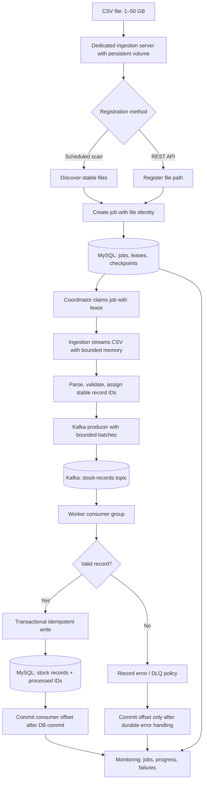
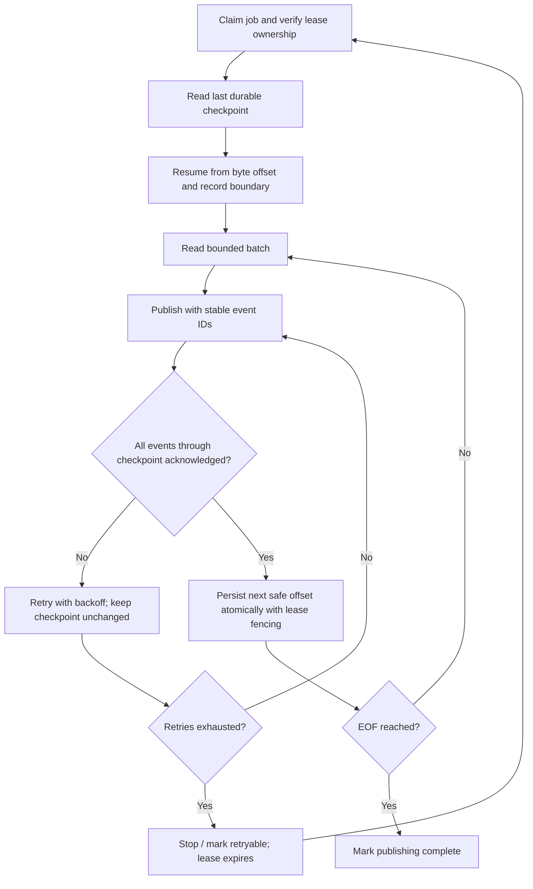
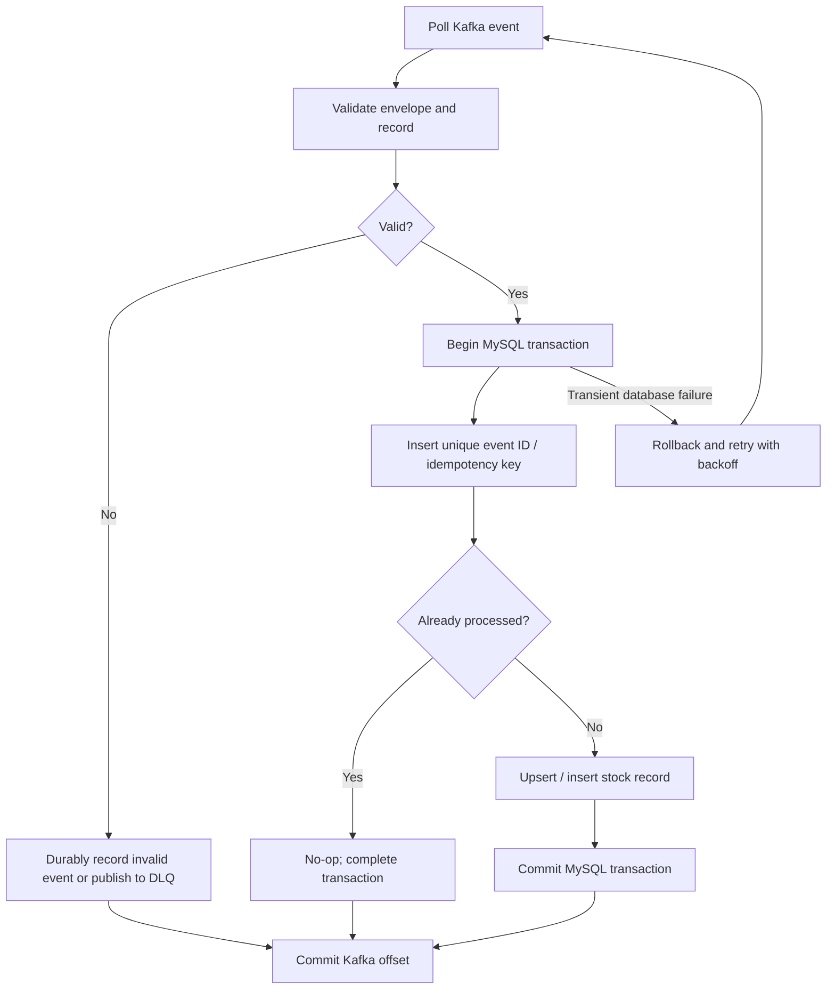
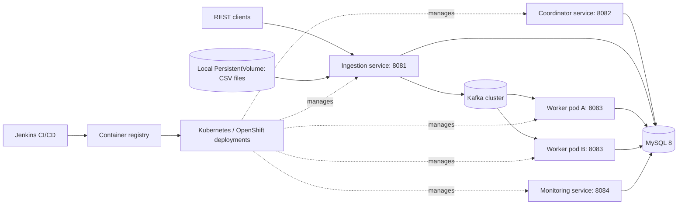
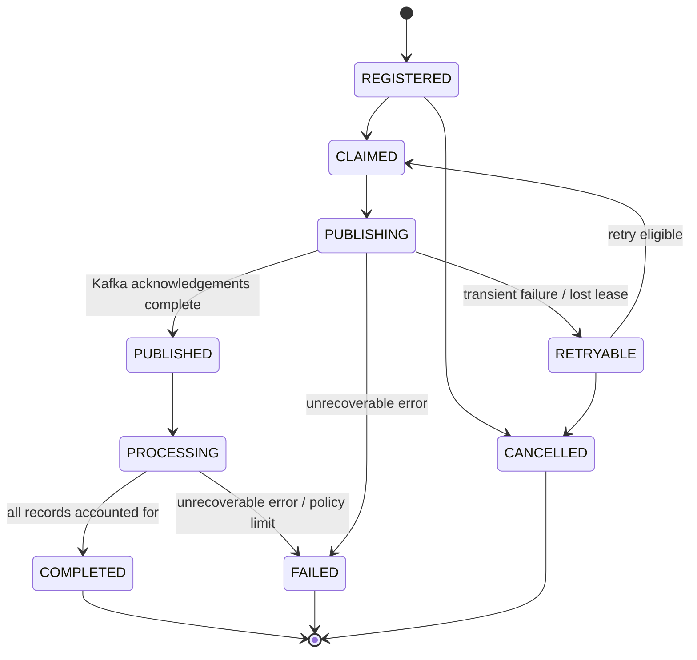

# Stock File Processing System — Flow Diagrams

**Target design:** Java 25, Spring Boot 4.1.2, Maven multi-module, MySQL 8, Kafka, Docker, Jenkins, Kubernetes/OpenShift. The diagrams describe planned processing behavior, not features already implemented. The initial service skeletons and health endpoints have been verified.

## 1. End-to-end processing

## 2. Safe producer checkpoint and recovery

**Invariant:** The durable producer checkpoint never advances beyond Kafka-acknowledged records. Replay after a crash is expected; consumer idempotency prevents duplicate business writes. CSV byte offsets must be recorded at valid record boundaries and the file identity must be checked on resume.

## 3. Consumer idempotency and retry

**Invariant:** Commit Kafka offsets only after the corresponding database transaction or durable error handling succeeds. A crash between DB commit and Kafka offset commit may replay the event; the unique event ID makes that replay safe.

## 4. Deployment topology

**Deployment constraint:** Only the ingestion workload that has access to the dedicated local PV can read the CSV files. Keep ingestion single-active unless shared storage or an explicit leader/lease model is introduced. Worker pods can scale horizontally subject to Kafka partition count and database capacity.

## 5. Job lifecycle

**Important:** Publishing complete is not the same as processing complete. Completion requires durable accounting for successfully processed and rejected records, including in-flight Kafka messages.

## 6. Service boundaries

| Module | Responsibility | Local port |
|---|---|---:|
| stock-common | Shared contracts, DTOs, stable identifiers | — |
| stock-ingestion-service | Registration, scan, CSV streaming, Kafka publishing | 8081 |
| stock-coordinator-service | Job ownership, leases, retries, coordination | 8082 |
| stock-worker-service | Kafka consumption, validation, idempotent MySQL writes | 8083 |
| stock-monitoring-service | Progress, job status, failures and metrics API | 8084 |

## 7. Implementation notes

- Preserve `com.stockprocessing` as Maven groupId and Java package root.
- MySQL InnoDB transactions are used for durable job state, fencing tokens and unique idempotency keys.
- File registration should reject duplicates using an explicit file identity policy; changed files must not silently reuse checkpoints.
- Persist record-level failures durably, with a DLQ for events that cannot be processed according to policy.
- Use backpressure, bounded buffers and Kafka producer acknowledgements to avoid unbounded heap growth.
- Treat monitoring progress as eventually consistent and define counts precisely (read, published, processed, rejected).
- The exact SQL schema, API payloads, lease fencing mechanism, and Kafka topic configuration should be finalized during their respective development tasks.
