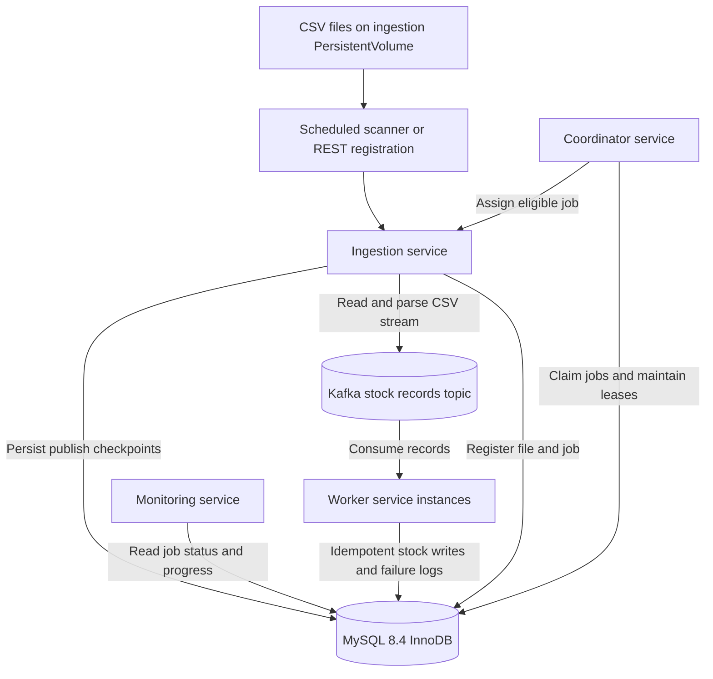
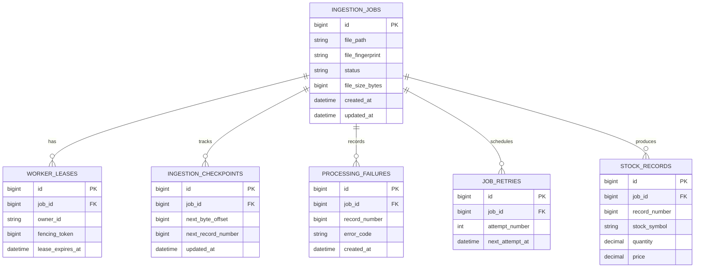
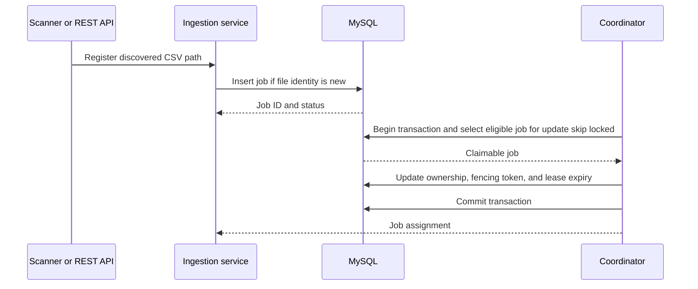
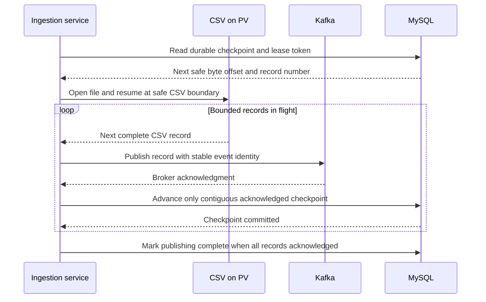
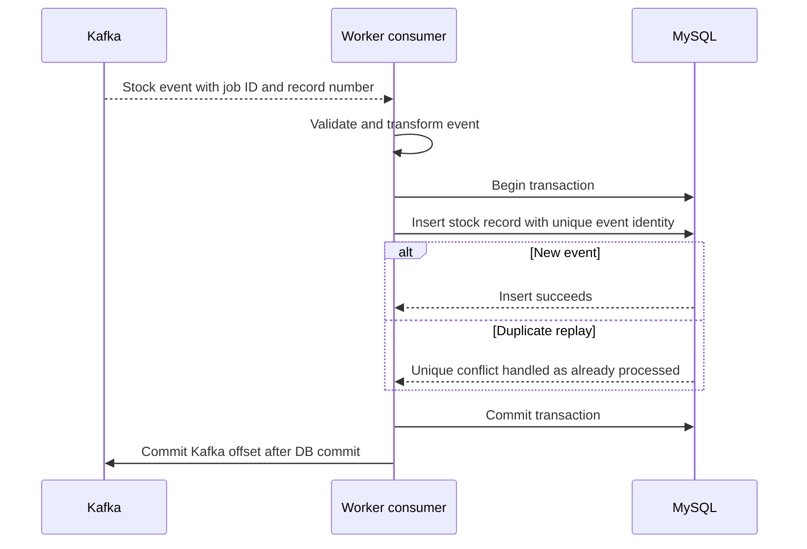
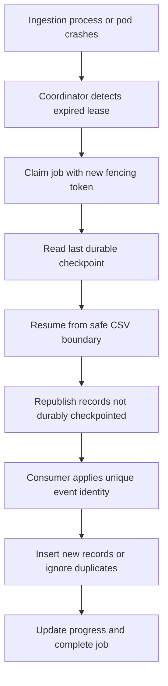
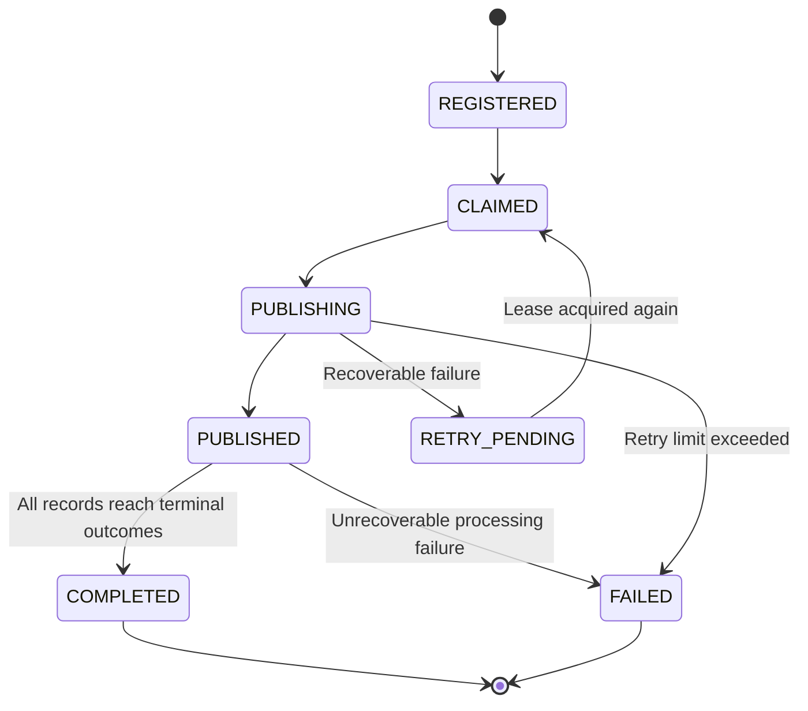

# Stock File Processing System — Database Data Flow

## 1. Purpose

This document describes how the ingestion, coordination, worker, and monitoring services interact with MySQL 8.4 and Kafka when processing 1–50 GB CSV files containing hundreds of millions of independent stock records.

**Stack:** Java 25, Spring Boot 4.1.2, MySQL 8.4 (InnoDB), Kafka, Docker, Kubernetes/OpenShift.

> This is the **target design** for Phase 2, not a claim that all tables and services have already been implemented. Table names and state transitions should be finalized during schema implementation.

## 2. High-level database data flow

## 3. Logical database entities

These fields are illustrative. Final types, unique keys, foreign keys, and indexes belong in the versioned Flyway migration scripts. For idempotency, a candidate uniqueness constraint is `(job_id, record_number)` on `STOCK_RECORDS` (or a stable event ID if the record model requires it).

## 4. Job registration and claiming

**Design rules:** Registration must deduplicate using a stable file identity (for example, canonical path plus verified fingerprint). Job claiming must be atomic. A lease protects coordination; the fencing token prevents stale owners from committing state after their lease has been replaced.

## 5. CSV streaming and Kafka checkpoint flow

**Critical:** Kafka acknowledgments can arrive out of order. The checkpoint must advance only past a contiguous range of successfully acknowledged records, and only while the current owner holds a valid lease/fencing token. A crash between Kafka acknowledgment and MySQL checkpoint commit can cause replay; downstream writes must therefore be idempotent. Use CSV-aware record boundaries rather than assuming every newline is a complete record when quoted multiline fields are supported.

## 6. Kafka consumption and MySQL persistence

For invalid records, use an explicit policy: record the failure and either route to a dead-letter topic or mark the record as terminally rejected before advancing its Kafka offset. A MySQL transaction cannot atomically commit a Kafka consumer offset; replay is expected and must be safe. The consumer should not acknowledge an event before the durable database outcome is committed.

## 7. Crash recovery

**Important:** A local PersistentVolume must be accessible to whichever ingestion instance resumes the job. With a single dedicated ingestion server, recovery must respect its storage topology. Kafka retention must be sufficient for consumer recovery, and file contents must remain immutable while a job is processed.

## 8. Job lifecycle

`PUBLISHED` means Kafka publishing finished; it does **not** mean consumers finished writing all stock records. To declare `COMPLETED`, define an authoritative completion mechanism such as per-job terminal outcome counts, with safeguards against duplicate counting and missing messages.

## 9. Table ownership and access

| Service | Writes | Reads |
| --- | --- | --- |
| Ingestion | `ingestion_jobs`, `ingestion_checkpoints` | Job details and current lease token |
| Coordinator | `ingestion_jobs`, `worker_leases`, `job_retries` | Eligible jobs, leases, retries |
| Worker | `stock_records`, `processing_failures`, terminal outcome progress | Event identity / job metadata as needed |
| Monitoring | None by default | Job state, checkpoint progress, failures |

Service boundaries are logical; implement least-privilege database credentials and avoid multiple services independently changing the same state machine without a defined transaction contract.

## 10. Operational design decisions

1. Use **Flyway** for versioned schema changes, with a single migration owner during deployment.
2. Use **InnoDB** for transactional job claims, checkpoints, and idempotent inserts.
3. Keep **CSV file bytes outside MySQL**; store metadata and checkpoints in MySQL.
4. Use **Kafka** to decouple file reading from record processing.
5. Use **unique constraints** to make duplicate event replay harmless.
6. Use **bounded producer concurrency** and contiguous-ack checkpointing to avoid skipping records.
7. Keep **lease expiry and fencing** consistent to prevent stale worker writes.
8. Distinguish **publishing progress** from **consumer completion progress**.
9. Design indexes and retention/partitioning for very large `stock_records` and failure tables.
10. Use **UTC timestamps**, stable record identifiers, and auditable retry decisions.

## 11. Next implementation steps

- Task 2.2: Configure Flyway and create an initial migration.
- Task 2.3: Finalize `ingestion_jobs` schema and file identity constraints.
- Task 2.4: Finalize worker leases and fencing.
- Task 2.5: Finalize CSV checkpoints and replay semantics.
- Tasks 2.6–2.7: Finalize failures, retries, stock records, and unique keys.
- Tasks 2.8–2.12: Implement atomic queries, recovery, repositories, and integration tests.

All diagrams use GitHub-compatible Mermaid fenced blocks, with node labels kept simple to avoid parser errors.
